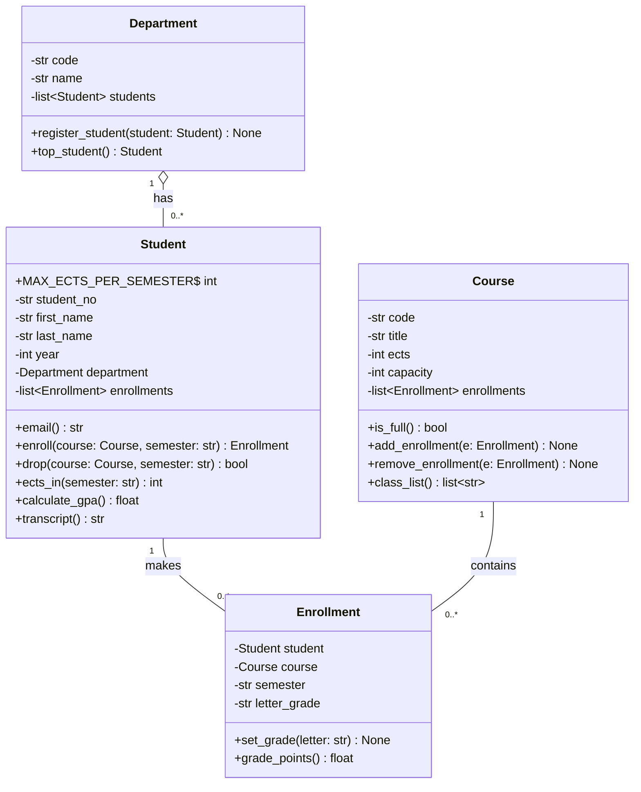

# Student Class Diagram — AII003 Homework

Mapping a UML **Student class diagram** to object-oriented Python code.

**Author:** Hakan Emre Yılmaz (20221703) — Near East University, Department of Computer Engineering

## UML Class Diagram



`Enrollment` is an **association class**: the many-to-many relationship between `Student` and `Course` has its own data (semester and letter grade), so it is modelled as a separate class instead of a plain list.

## Design → Code Mapping

| UML | Python |
|---|---|
| Class | One class per file (`student.py`, `course.py`, …) |
| Private attribute `-` | `_attribute` + read-only `@property` (encapsulation) |
| Public operation `+` | Public method |
| Static attribute `$` | Class variable `MAX_ECTS_PER_SEMESTER` |
| Derived attribute | `email` property computed from the student number |
| Aggregation (◇) | `Department` keeps a list of `Student` objects that exist on their own |
| 1 — 0..* association | List on the "1" side, single reference on the other side |
| Association class | `Enrollment` holds references to both `Student` and `Course` |
| Constraints | Checked in code: course capacity, ECTS limit, duplicate enrollment, valid grade |

## Project Structure

- `department.py` – `Department` class
- `student.py` – `Student` class
- `course.py` – `Course` class
- `enrollment.py` – `Enrollment` association class + grade table
- `main.py` – demo script

## How to Run

Requires Python 3.10+.

```bash
python main.py
```

## Sample Output

```
--- Enrollment ---
AII003 - Information and Communication Technologies (6 ECTS, 2/2 seats)
Class list: Hakan Emre Yilmaz, Ayse Demir
Mehmet could not enroll: AII003 is full (2 seats).

--- Grading ---
Hakan Emre Yilmaz (20221703) - Year 4
Computer Engineering
----------------------------------------
Fall 2026  AII003   6 ECTS  AA
Fall 2026  AII201   6 ECTS  BA
Fall 2026  ECC302   6 ECTS  CB
GPA: 3.33
```

## Resources

- UML 2.5 class diagram notation
- Mermaid `classDiagram` syntax (rendered by GitHub)
- Python documentation — classes and `@property`
